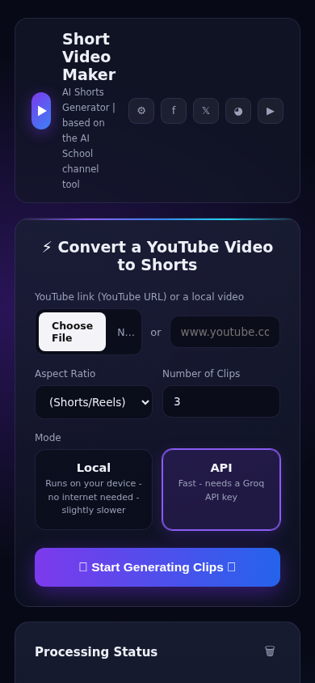
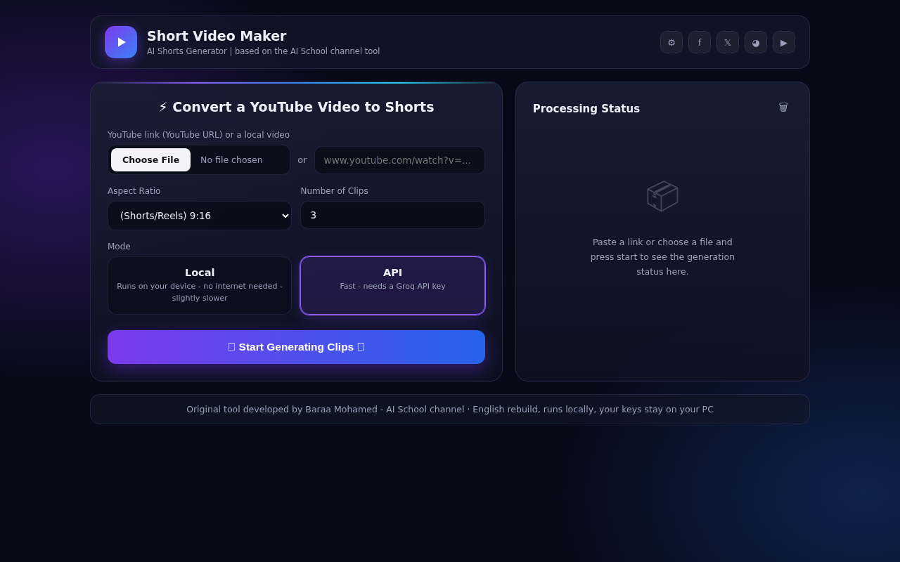

# AI Shorts Studio

| Mobile | Desktop |
| --- | --- |
|  |  |

Turns a long video (YouTube link or a file) into ready-to-post vertical clips with burned-in captions.
Runs on your own PC. You bring your own API keys and change everything from the Settings page.

How it works: download (yt-dlp) -> transcribe (Whisper) -> an LLM picks the best moments -> ffmpeg cuts, crops to 9:16 and burns animated word-by-word captions.

## Run (Windows)
1. Unzip the folder anywhere.
2. Double-click `run.bat`. The first run creates a virtual environment and installs the packages (about a minute). Needs Python 3.10+ and ffmpeg on PATH.
3. The browser opens at http://localhost:8000. Open **Settings**, paste your keys, press **Save**, then **Test connection**.
4. Go to **Create**, paste a link or upload a file, press **Generate clips**. Results land in the page and in the `outputs/` folder.

Mac/Linux: `./run.sh`.

## Keys (all optional, all in Settings)
- **Transcription:** `local` by default - faster-whisper runs on your PC, no key, first run downloads a ~150 MB model. Or use Groq (free tier, console.groq.com) with `whisper-large-v3-turbo`, or any OpenAI-compatible Whisper API. If an API transcription fails because the server cannot transcribe (e.g. FreeLLMAPI, which has no speech-to-text endpoint), the app falls back to local automatically and says so in the log.
- **LLM picker:** presets for Groq, FreeLLMAPI (base URL `http://127.0.0.1:3001/v1` - change the port to yours, model `auto`, key = your unified key from the FreeLLMAPI dashboard), Gemini, OpenRouter, OpenAI, or Custom (any OpenAI-compatible URL + model name). Set provider to `none` to skip the LLM; a local heuristic then picks clips (speech density, hook words, loudness).
- Model names change over time. If a test says "model not found", edit the Model field to a current one from your provider.
- Keys are stored only in `data/settings.json` on your PC. Do not share that file.

## What you can edit in Settings
The LLM prompt, number/length of clips, format (9:16, 1:1, 4:5, 16:9), framing (crop or blurred background), caption font/size/colors/position/words per line/highlight, output quality, YouTube cookies.

## Notes
- If YouTube says "confirm you're not a bot", set "Use cookies from browser" to `chrome` (or `edge`/`firefox`) in Settings > Downloading, or just upload the file.
- Use videos you own or have permission to clip.
- Code layout: `app.py` (server), `engine/` (config, media, transcribe, analyze, render, pipeline), `static/index.html` (UI). Change `engine/render.py` for the caption look beyond what Settings offers.

## Changelog
- v1.4 (Nov 26, 2026): fix "open() got an unexpected keyword argument 'metadata_errors'" during local transcription. faster-whisper's decoder needs PyAV 12+ but only asks for 11+, so some PCs got a too-old av. requirements now pin av>=12.3.0, local transcription decodes audio with ffmpeg instead of PyAV so any av version works, and run.bat/run.sh re-check packages on every start so existing installs pick up fixes.
- v1.2 (Nov 26, 2026): transcription defaults to local (no key needed); faster-whisper is now installed by run.bat; new FreeLLMAPI preset for the AI clip picker; automatic fallback to local Whisper when the configured API cannot transcribe, with a log line saying so.
- v1.1 (Nov 26, 2026): clear API error messages. If a transcription/LLM call fails you now see the HTTP status, a hint (wrong key, rate limit, ...), and a warning when the base URL is wrong (e.g. console.groq.com instead of api.groq.com) or a non-JSON reply comes back, instead of "Expecting value: line 1 column 1 (char 0)".
- v1.3 (Nov 26, 2026): full UI rebuild to match the AI School channel tool screen-for-screen, in English: new single-page layout (file/URL row, aspect + clip count, Local/API mode cards, gradient start button), live Processing Status panel with log, result cards with AI reason / hook / score / duration / file path / download, settings as a popup with Groq key + Save alert (advanced options kept under a collapsible), header with social icons and footer credit. Clips now also carry the opening line (hook) from the AI picker.

## Credit

Built by Davinci with Instinct (AI assistant), November 2026.
